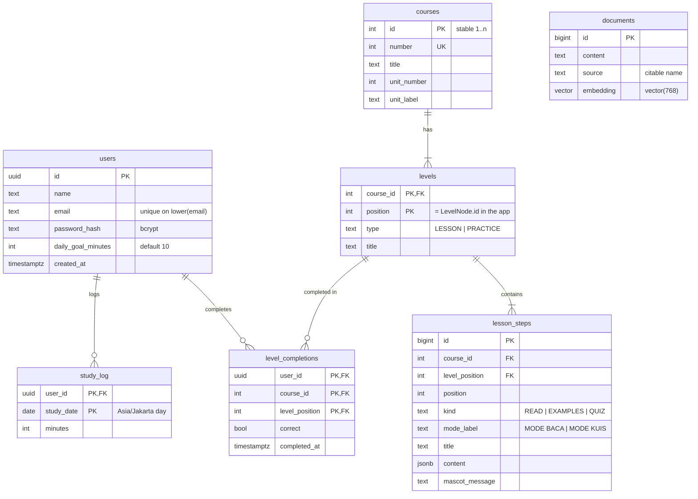

# CLAUDE.md

This file provides guidance to Claude Code (claude.ai/code) when working with code in this repository.

## What this is

Legaloo backend. It is the server for the **Legaloo Android app**, a Duolingo-style app that teaches basic Indonesian law to young learners through short levels, a daily study goal and a weekly streak. The app lives in a separate repo (`C:\Users\golde\AndroidStudioProjects\Legaloo`, Kotlin + Jetpack Compose, package `org.ambatujudge.legaloo`). This repo (FastAPI, developed in WSL) has two jobs:

1. **"Tanya Legaloo" chat**: a RAG service that answers legal questions in Bahasa Indonesia. Retrieval and prompt assembly run here. Embeddings and generation are remote calls to the Google Gemini API. Vectors live in Supabase Postgres with pgvector. Implemented.
2. **App data API**: accounts, courses/levels, lesson content and per-user progress. These replace the hard-coded `DummyData` in the app. **Not implemented yet.** This is the current task (below). The full contract is under "App contract".

It deploys to Vercel as a Python serverless function. Supabase is used **only as Postgres**. The backend talks to it through asyncpg with `DATABASE_URL`. No Supabase Auth, no supabase-py, no PostgREST.

## Current task: working backend for the demo (2026-11-24)

Goal: by demo time, the Android app can register/log in, show real courses and progress, play lessons from the database, complete levels (unlocking the next one), and ask the chat questions. Work in this order and keep each step runnable. If time runs short, cut from the bottom.

1. **Database.** `db/schema.sql` and `db/seed.sql` are already written and tested. Run them in the Supabase SQL editor (schema first, then seed). `db/queries.sql` has tested SQL for the course-state and streak logic. Port it into the repositories instead of rewriting it.
2. **Fix the embedding dimension bug.** Send `outputDimensionality: 768` (see Database).
3. **Auth.** `POST /auth/register`, `POST /auth/login`, `GET /me`. Use your own `users` table, `bcrypt` for hashing and `PyJWT` (HS256) for tokens. Add `JWT_SECRET` and `JWT_EXPIRE_DAYS` (default 30) to `core/config.py` and `.env.example`. A `get_current_user` dependency in `api/deps.py` reads `Authorization: Bearer`. Add `bcrypt` and `pyjwt` to `[project].dependencies`. Both are small and fine for the Vercel bundle.
4. **Courses and progress.** `GET /courses`, `GET /courses/{courseId}`, `GET /me/progress`.
5. **Lessons.** `GET /courses/{courseId}/levels/{levelId}/lesson` and `POST /courses/{courseId}/levels/{levelId}/complete`.
6. **Errors.** One exception handler so every error is `{"detail": "<pesan Indonesia>", "field": <str|null>}`, including 422 validation errors (map them to the AuthValidator messages listed below, never the raw Pydantic text).
7. **Chat corpus for the demo.** Ingestion is still a stub, so `documents` is empty and RAG returns nothing. Quick fix: add `scripts/ingest_lessons.py` (`ingest` group, run locally) that reads every `READ` step's paragraphs from `lesson_steps`, embeds each paragraph with `RETRIEVAL_DOCUMENT` at 768 dims and inserts it into `documents` with `source` = the level title. Also: when retrieval returns zero chunks, the chat must still answer, with a short note in Indonesian that it is general information. It must not crash or stream an empty response.
8. **Tests.** Cover the happy path and the main errors for auth, courses and complete. Mock Gemini.
9. **Deploy.** `vercel`, set env vars (`DATABASE_URL`, `GEMINI_API_KEY`, `JWT_SECRET`) in the Vercel dashboard, then run the smoke test against the deployed URL.

Out of scope for the demo: Android-side changes (done separately), password reset, editing the profile, admin endpoints for authoring lessons, real PDF ingestion.

**Done when** this smoke test passes locally and against Vercel (`B=http://localhost:8000`):

```sh
curl -s -X POST $B/auth/login -H 'content-type: application/json' -d '{"email":"budi@legaloo.id","password":"legaloo123"}'   # -> token + user Budi Santoso
T=<token>
curl -s $B/me/progress -H "authorization: Bearer $T"     # streakCount 7, minutesStudied 6, dailyGoalMinutes 10, currentCourseId 1, currentUnitNumber 2
curl -s $B/courses -H "authorization: Bearer $T"         # course 1: levels 1-2 COMPLETED, 3 ACTIVE, progress 0.4, isCurrent true
curl -s $B/courses/1/levels/4/lesson -H "authorization: Bearer $T"   # 403 "Selesaikan level sebelumnya dulu ya!"
curl -s $B/courses/1/levels/3/lesson -H "authorization: Bearer $T"   # READ + QUIZ steps
curl -s -X POST $B/courses/1/levels/3/complete -H "authorization: Bearer $T" -H 'content-type: application/json' -d '{"correct":true,"minutesSpent":4}'   # level 3 COMPLETED, 4 ACTIVE
curl -s $B/me/progress -H "authorization: Bearer $T"     # minutesStudied 10, streakCount 8 (today's goal now met)
curl -s -X POST $B/auth/login -H 'content-type: application/json' -d '{"email":"budi@legaloo.id","password":"salah123"}'   # 401 "Email atau kata sandi salah"
curl -N -X POST $B/chat -H 'content-type: application/json' -d '{"query":"Apakah penumpang motor wajib pakai helm?","voice_mode":false}'   # streams an answer
```

Re-run `db/seed.sql` after testing and again on the morning of the demo. It resets the demo accounts and dates their progress relative to today (WIB).

## Commands

Tooling is `uv` (Python 3.12, src layout, package name `legaloo`).

```sh
uv sync                                          # install runtime + dev deps
uv run uvicorn legaloo.main:app --reload --host 0.0.0.0 --port 8000   # dev server; OpenAPI docs at /docs
uv run pytest                                    # all tests
uv run pytest tests/test_health.py::test_health  # single test
uv run ruff check .                              # lint
uv run ruff format .                             # format
uv run --group ingest python scripts/ingest.py ./corpus   # offline ingestion (still a stub)
vercel                                           # deploy
```

Configuration comes from `.env` (copy `.env.example`) and is read by `core/config.py` through pydantic-settings. `DATABASE_URL` and `GEMINI_API_KEY` must be set before `/chat` will work. `/health` needs neither. New settings go in `core/config.py` **and** `.env.example`.

### Reaching the dev server from the Android app

- `--host 0.0.0.0` is required. Without it uvicorn listens only on WSL's loopback.
- Android emulator → host machine is `http://10.0.2.2:8000`. WSL2 forwards Windows `localhost` to WSL, so this normally reaches uvicorn running in WSL. If it doesn't, use the WSL IP (`hostname -I`) or set up `netsh interface portproxy`.
- Physical device over USB: `adb reverse tcp:8000 tcp:8000`, then use `http://localhost:8000` in the app.
- The app does not have networking set up yet. It needs `<uses-permission android:name="android.permission.INTERNET" />`, and plain-HTTP dev URLs need a debug-only `networkSecurityConfig` that allows cleartext. Production uses the HTTPS Vercel URL.

## Architecture

Layering: `api/routes` → `services` → `repositories` → `db`. `schemas/` holds the Pydantic models shared across layers (`ChatRequest`, `Chunk`). Routes stay thin: parse, call a service, shape the response. SQL lives only in `repositories/`. New code follows the same layering (for example `api/routes/courses.py` → `services/course_service.py` → `repositories/course_repository.py`).

### Chat flow (`POST /chat`, body `{query, voice_mode}`), all in `src/legaloo/`

`api/routes/chat.py` → `services/chat_service.answer()`, an async generator that runs these steps:

1. `embedding_service.embed_query`: Gemini `embedContent` with `taskType=RETRIEVAL_QUERY`.
2. `repositories/document_repository.search_similar`: cosine search (`<=>`) over the `documents` table. The embedding is sent as a `'[...]'` string cast to `::vector`, so no pgvector codec is registered on asyncpg.
3. `prompt_service.build_prompt`: packs chunks up to `MAX_CONTEXT_CHARS`. It picks voice rules (at most 2 sentences, plain text, numbers written as words) or text rules (cite sources). The rules are deliberately repeated after the context. Don't remove the repetition.
4. `llm_service.stream_completion`: Gemini `streamGenerateContent?alt=sse`. It parses SSE lines and yields text pieces.

The route wraps the generator in a `StreamingResponse` (`text/plain; charset=utf-8`). It streams so voice clients can start TTS early, so keep the path streaming end to end: no buffering the full answer, no middleware that reads the body.

**Voice mode:** speech-to-text and text-to-speech run **on the device** (small quantized Indonesian models). The backend only receives and returns text. `voice_mode=true` only changes the prompt rules so the output is easy to speak. Never return markdown, URLs or digits in voice mode.

**Client side:** the Android client should read the response body incrementally (OkHttp `response.body.source()`, reading as bytes arrive), not with `.string()`. Keep the response format as plain text chunks unless the app is changed at the same time. If structured events are needed later (sources, errors mid-stream), move to SSE in both repos together.

### Serverless constraints (these drive several design choices)

- **Entrypoint**: Vercel loads `api/index.py`, a shim that adds `src/` to `sys.path` and re-exports `app`. New routers must be registered in `src/legaloo/main.py`.
- **Bundle size**: Vercel bundles everything reachable and does no tree-shaking. Keep heavy or local-only dependencies (PDF parsing, ML libs, dotenv) in the `ingest` dependency group, never in `[project].dependencies`. Nothing on the request path may import from `scripts/`. `vercel.json` excludes `scripts`, `tests`, `corpus`, `notebooks`, and `.venv` from the function.
- **Warm-instance reuse**: `core/http.client()` (a shared `httpx.AsyncClient`) and `db/session.get_pool()` (an asyncpg pool, max 4 connections) are lazy module-level singletons. Reuse them instead of creating clients or connections per request. `get_settings()` is `lru_cache`d.
- **No local state**: instances are ephemeral and run in parallel. Don't keep sessions, progress or caches that must persist in memory or on disk. Everything durable goes in Postgres.
- **Supabase pooler**: when connecting through the Supabase transaction pooler (port 6543), asyncpg prepared statements break. Create the pool with `statement_cache_size=0`.
- Region is pinned to `sin1`, and the function has a 60s `maxDuration`. A chat answer must finish streaming within that limit.

### Database

The schema is versioned in `db/` and applied by hand in the Supabase SQL editor (there is no migration tool):

- `db/schema.sql`: all tables, idempotent. RLS is enabled with **no policies** on every table. The backend connects as `postgres` (bypasses RLS), and the public Supabase REST API can't read anything. Don't add policies, and never put the service-role key in the app.
- `db/seed.sql`: the curriculum (4 courses, 19 levels, 43 lesson steps, all in Indonesian) plus 2 demo accounts with progress. Re-runnable.
- `db/queries.sql`: tested SQL for computing course/level states, the current course and the streak.

Schema changes go into `schema.sql` (keep it idempotent: `if not exists`, `on conflict`) and are pasted into Supabase.



`documents` (RAG) is not related to the other tables.

Design notes:
- Levels use `(course_id, position)` as their key because the app's `LevelNode.id` is 1..n within each course. URLs use `/courses/{courseId}/levels/{position}`.
- `state`, `progress`, `isCurrent`, streak and minutes are **never stored**. They are computed from `level_completions` and `study_log` on every request (see `db/queries.sql`). Courses are independent: each course's first unfinished level is `ACTIVE`.
- **Images:** lessons don't store image files. The app draws its pictures in code (Compose `Canvas`, not SVG), so a step's JSON can carry an `illustration` key that the app maps to a drawing. Keys in use: `CROSSING_GREEN` (pedestrian light green, no car) and `CROSSING_RED_CAR` (light red, car coming). An unknown or missing key means the app shows no picture. If real images are needed later, upload them to Supabase Storage and add an optional `imageUrl` next to `illustration`. Don't change the schema for it, because `content` is jsonb.

**Known bug, embedding dimension:** the column is `vector(768)`, but `embed_query` does not send `outputDimensionality`. `gemini-embedding-001` returns 3072 dimensions by default, so inserts and searches fail. Fix: send `"outputDimensionality": 768` in **both** `embed_query` and ingestion (one shared helper). Embeddings at reduced dimensions are not unit-normalized. That is fine for cosine (`<=>`) but not for inner product (`<#>`). Query and document embeddings must always use the same model and dimension as the column.

## App contract

The shapes below come from the app's `data/Models.kt`, so the Android side can swap `DummyData` for API calls with minimal changes. JSON field names are **camelCase** to match the Kotlin data classes (Pydantic `alias_generator=to_camel`, `populate_by_name=True`, serialize `by_alias`). Enums are uppercase strings matching the Kotlin enum names. Every endpoint except `/auth/*`, `/health` and `/chat` requires `Authorization: Bearer <token>`. Missing or bad token → 401 `"Sesi berakhir, silakan masuk lagi"`.

Error body, always: `{"detail": "<pesan>", "field": "name"|"email"|"password"|null}`. The app shows the message under that field, or as a form error when `field` is null.

### Auth: replaces `AuthRepository`

- `POST /auth/register` `{name, email, password}` → 201 `{"token": "...", "user": {"id", "name", "email"}}`. Trim name and email. Store the email lowercased.
- `POST /auth/login` `{email, password}` → 200, same body.
- `GET /me` → `{"id", "name", "email", "dailyGoalMinutes"}`.
- Validation copies the app's `viewmodel/AuthValidator.kt`. Use these exact messages:

  | field | rule | message |
  |---|---|---|
  | name | blank | `Nama wajib diisi` |
  | name | < 3 characters after trim | `Nama minimal 3 karakter` |
  | name | not `^[A-Za-z .'-]+$` | `Nama hanya boleh berisi huruf dan spasi` |
  | email | blank | `Email wajib diisi` |
  | email | not `^[A-Za-z0-9._%+-]+@[A-Za-z0-9.-]+\.[A-Za-z]{2,}$` | `Format email tidak valid` |
  | email | already registered (case-insensitive) → 409 | `Email sudah terdaftar` |
  | password (register) | empty | `Kata sandi wajib diisi` |
  | password (register) | < 8 characters | `Kata sandi minimal 8 karakter` |
  | password (register) | no letter or no digit | `Kata sandi harus berisi huruf dan angka` |
  | password (login) | empty | `Kata sandi wajib diisi` |
  | login | wrong email or password → 401, `field: null` | `Email atau kata sandi salah` |

  Validation errors return 422 with the first failing field's message.
- Demo accounts (from `db/seed.sql`, same as the app's `DummyData`): `budi@legaloo.id` / `legaloo123` (Budi Santoso, has progress and a 7-day streak), `siti.rahma@gmail.com` / `hukum2026` (Siti Rahmawati, fresh account).

### Courses: replaces `CourseViewModel` / `DummyData.courses`

`GET /courses` → `Course[]` ordered by `number`. `GET /courses/{courseId}` → one `Course`, or 404 `"Kursus tidak ditemukan"`.

```json
{ "id": 1, "number": 1, "title": "Hak dan Kewajiban", "progress": 0.4,
  "unitLabel": "KURSUS 1, UNIT 2", "isCurrent": true,
  "levels": [ { "id": 1, "type": "LESSON", "state": "COMPLETED", "title": "Apa Itu Hak?" } ] }
```

- `progress` = completed levels / total levels (float 0–1).
- `state`: completed → `COMPLETED`; the course's lowest unfinished position → `ACTIVE`; the rest → `LOCKED`.
- `isCurrent`: true for exactly one course. Use the course of the user's most recent completion if it still has unfinished levels. Otherwise use the lowest-numbered course with unfinished levels. Otherwise course 1.
- `title` on levels is extra (the Kotlin `LevelNode` ignores unknown fields if the app's JSON parser has `ignoreUnknownKeys = true`, which the Android side should set).

### Lessons: replaces the hard-coded `CourseMaterial1Screen`

`GET /courses/{courseId}/levels/{levelId}/lesson` →

```json
{ "courseId": 4, "levelId": 1, "type": "LESSON", "title": "Rambu dan Lampu Lalu Lintas",
  "steps": [
    { "position": 1, "kind": "READ", "modeLabel": "MODE BACA", "title": "...", "mascotMessage": "Ayo kita lanjut!",
      "content": { "paragraphs": ["...", "..."] } },
    { "position": 2, "kind": "EXAMPLES", "modeLabel": "MODE BACA", "title": "Menyeberang dengan Aman", "mascotMessage": "...",
      "content": { "examples": [ { "label": "CONTOH BAIK", "tone": "GOOD", "caption": "...", "illustration": "CROSSING_GREEN" } ] } },
    { "position": 3, "kind": "QUIZ", "modeLabel": "MODE KUIS", "title": null, "mascotMessage": "Pilih jawabanmu!",
      "content": { "question": "...", "options": [ { "text": "...", "correct": false } ],
                   "feedbackCorrect": "Benar! ...", "feedbackWrong": "Kurang tepat. ..." } } ] }
```

- Pass `content` through unchanged from the jsonb column. Its keys are already camelCase. Model it as `dict` (or a discriminated union on `kind`, if time allows).
- A `LESSON` is 1–2 `READ`/`EXAMPLES` steps followed by one `QUIZ`. A `PRACTICE` level is 3 `QUIZ` steps. Each quiz has exactly 4 options and one correct answer.
- `LOCKED` level → 403 `"Selesaikan level sebelumnya dulu ya!"` (same text as the app's snackbar). Unknown level → 404 `"Level tidak ditemukan"`. `COMPLETED` levels can be replayed.
- The answer is included so the app grades offline. This is not security-sensitive.

`POST /courses/{courseId}/levels/{levelId}/complete` `{"correct": true, "minutesSpent": 4}` → `{"course": Course, "progress": UserProgress}`

- 403 if the level is `LOCKED`. Upsert into `level_completions`, so replaying a completed level is fine (update `completed_at`).
- Clamp `minutesSpent` to 0–60. Add it to today's (WIB) `study_log` row with `insert ... on conflict (user_id, study_date) do update set minutes = study_log.minutes + excluded.minutes`.
- Run the completion and the minutes update in one transaction.

### Home progress: replaces `HomeViewModel` / `DummyData.userProgress`

`GET /me/progress` →

```json
{ "userName": "Budi Santoso", "streakCount": 7, "minutesStudied": 6, "dailyGoalMinutes": 10,
  "week": [ { "label": "S", "completed": true }, { "label": "S", "completed": true }, { "label": "R", "completed": true },
            { "label": "K", "completed": false }, { "label": "J", "completed": false }, { "label": "S", "completed": false }, { "label": "M", "completed": false } ],
  "currentCourseId": 1, "currentUnitNumber": 2 }
```

- "Today" is `(now() at time zone 'Asia/Jakarta')::date`, computed in SQL. Never use the server clock in Python: Vercel runs in UTC.
- `minutesStudied` is today's `study_log.minutes` (0 if there is no row).
- `week` covers the current Monday–Sunday week with labels `S S R K J S M`. `completed` = minutes ≥ `daily_goal_minutes` on that day. Future days are `false`.
- `streakCount`: the number of consecutive days, counting back, on which the goal was met. Start counting from today if today's goal is met, otherwise from yesterday, so the streak doesn't break before the day ends.
- `currentCourseId` = the `isCurrent` course. `currentUnitNumber` = that course's `unit_number`.

### Not needed from the backend (yet)

- Study reminders (`ReminderScreen` / `NotificationHelper`) are local Android notifications. They don't need push or FCM.
- The Profile tab is a placeholder in the app. `GET /me` is enough for now.

## Ingestion

`scripts/ingest.py` is a TODO stub. The intended pipeline: walk `*.pdf` under the corpus dir → extract text → chunk → embed with `taskType=RETRIEVAL_DOCUMENT` and `outputDimensionality=768` → upsert into `documents` with `source` set to a citable name (for example `"UU No. 22 Tahun 2009, Pasal 106"`), not a file path, because the text-mode prompt cites it to users. Use chunk boundaries that follow legal structure (Pasal/ayat) where possible. Re-running ingestion must not duplicate rows: upsert on a content hash or clear rows by `source` first. `corpus/` is gitignored. Ingestion runs locally only, never on Vercel.

The course topics (rights and duties, school rules, family law, traffic) suggest which sources the corpus should cover first.

## Conventions

- Prompts, error messages and all user-facing text are in Bahasa Indonesia. Code, identifiers and comments are in English. The audience is young learners, so answers should be simple and friendly, not legalese.
- JSON uses camelCase field names that match the Kotlin models. Enums are uppercase strings.
- Everything on the request path is async (asyncpg, httpx). No blocking I/O in route handlers.
- Tests use FastAPI `TestClient`. `pytest-asyncio` is installed but not configured in `pyproject.toml`. Set `asyncio_mode = "auto"` before writing async tests. Mock Gemini calls in tests. Never hit the real API or the production database from tests.
- An API contract change (field name, enum value, error string) breaks the Android app. Update both repos together and keep the "App contract" section above and `db/` current.